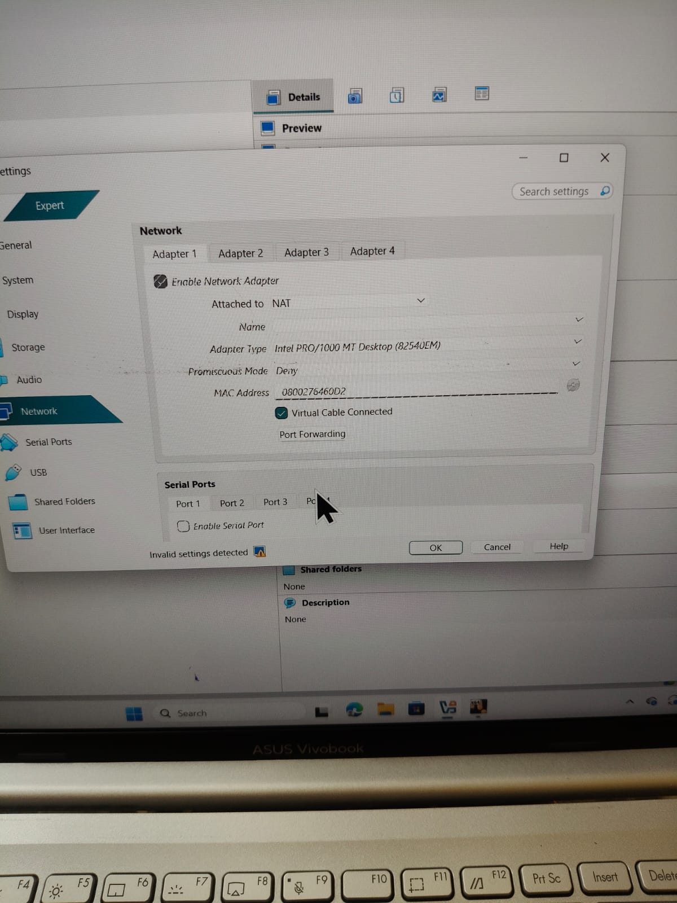
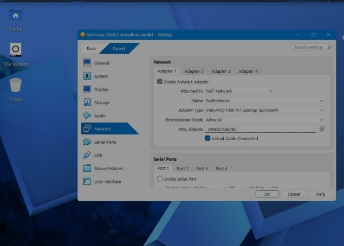
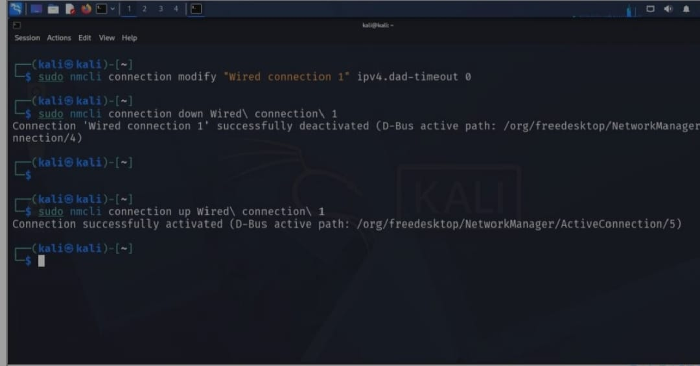
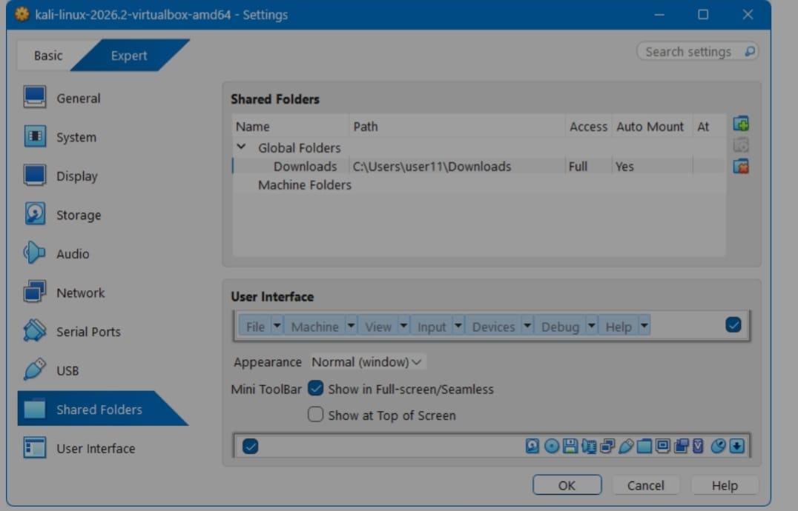

# NETWORKWALKS – B084N Internship

**Task:** Install Oracle VirtualBox and Kali Linux, then configure the virtual machine for penetration testing.

This repository contains my submission for the **NetworkWalks B084N Internship** task. The four screenshots document the VirtualBox installation, the Kali Linux virtual machine setup, the network configuration, and the final verification steps.

## Objective

- Install Oracle VirtualBox on the host machine.
- Install / import Kali Linux as a virtual machine.
- Configure networking so the Kali VM has internet access and can reach the host.
- Fix common Kali network issues (IPv6 DAD timeout, unmanaged connection).
- Enable Shared Folders for easy file transfer between host and Kali.
- Verify the setup and use it as a penetration-testing lab.

## Environment

| Component | Details |
|---|---|
| Host OS | Windows (ASUS Vivobook) |
| Virtualization | Oracle VirtualBox |
| Guest OS | Kali Linux (`kali-linux-2026.2-virtualbox-amd64`) |
| Network Adapter | Intel PRO/1000 MT Desktop (82540EM) |
| Networking Mode | NAT / NAT Network |

## Steps Performed

### 1. VirtualBox Network Adapter (NAT)

The host-side VirtualBox network settings were configured with **Adapter 1** enabled, attached to **NAT**, using the **Intel PRO/1000 MT Desktop (82540EM)** adapter type, and **Virtual Cable Connected** ticked.



### 2. Kali Linux NAT Network

Inside the Kali VM settings, **Adapter 1** was attached to the **NAT Network** named `NatNetwork`, with **Promiscuous Mode** set to **Allow All**. This gives the Kali machine outbound internet access while keeping it on an isolated lab network suitable for penetration testing.



### 3. Kali Network Fix (`nmcli`)

Kali sometimes fails to bring up the wired connection (IPv6 duplicate address detection timeout). The issue was resolved from the terminal with NetworkManager:

```bash
sudo nmcli connection modify "Wired connection 1" ipv4.dad-timeout 0
sudo nmcli connection down Wired\ connection\ 1
sudo nmcli connection up Wired\ connection\ 1
```

The output confirms the connection was deactivated and re-activated successfully.



### 4. Shared Folders

A shared folder was added so files can be moved between the Windows host and Kali:

- **Name:** Downloads
- **Path:** `C:\Users\user11\Downloads`
- **Access:** Full
- **Auto Mount:** Yes



## Result

VirtualBox and Kali Linux are installed and working. The Kali VM boots, has network connectivity through the NAT network, the wired connection is stable, and shared folders are enabled — providing a ready-to-use penetration-testing environment for the internship tasks.

## Repository Contents

| File | Description |
|---|---|
| `README.md` | Task documentation |
| `01-virtualbox-network-adapter-nat.jpeg` | Host VirtualBox adapter set to NAT |
| `02-kali-nat-network-settings.jpeg` | Kali VM attached to NAT Network |
| `03-kali-nmcli-network-fix.jpeg` | Fixing the Kali network with `nmcli` |
| `04-virtualbox-shared-folders.jpeg` | Shared folder configuration |
